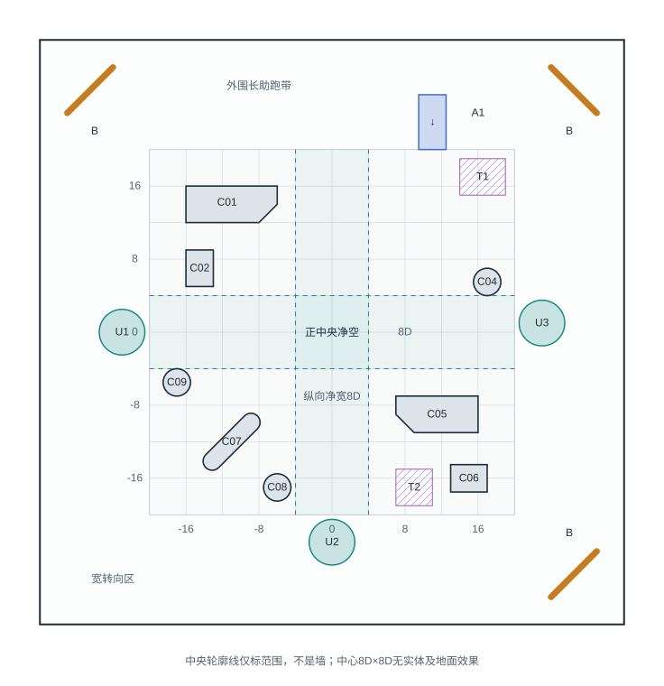

# 第一张地图：折射广场

团队讲解版 · 2026-10-22  
阶段：概念方案，尚未搭建；布局采用C03挡板已移除的版本。

## 1. 这张地图想带来什么体验

折射广场是一张近方形的开放竞技场，怪物会持续在场内生成。玩家需要观察怪群的位置，在场地中寻找助跑空间、获取加速，并利用碰撞或切换形态调整方向，组织下一次冲撞。

这张地图围绕一个问题展开：**当前这条路线，能否让我带着足够的速度撞向目标？**

玩家既要关心速度，也要关心接下来会撞向哪里。环境中的物件为玩家提供建立速度、改变方向和减速重整的机会。

## 2. 先看整体布局

看图时可以从三个部分理解：

| 区域 | 玩家可以做什么 | 设计目的 |
| --- | --- | --- |
| 外围开阔带 | 长距离助跑、拉开距离，再选择进入中央的位置 | 给玩家建立和维持速度的空间 |
| 中央交叉区域 | 横向或纵向穿过场地，冲向另一侧的怪群 | 提供直接、容易识别的进攻路线 |
| 中央周围的四组障碍 | 绕行、穿缺口，或选择合适的碰撞面反弹 | 让不同位置有不同的路线选择 |

**正中央保持空旷。** 障碍放在它周围，避免玩家每次穿场都被迫撞上中心障碍。中央空旷不代表安全：怪物仍可进入或生成在这里。

图中的网格、虚线及中央方框都是设计辅助标记，不是实体墙。尺寸单位D代表玩家球形态的碰撞直径，具体尺度将在白盒阶段调整。

## 3. 玩家如何利用场地

球形态可以沿当前运动方向加速，但不能通过方向输入主动转弯。机器人形态可以主动转向，同时会自然减速。因此，一次路线选择通常包含：

**观察目标 → 对齐路线 → 建立速度 → 冲撞 → 借碰撞或切形态调整 → 再次进攻。**

碰撞敌人时，以当时的速度判断是否达到秒杀阈值；小型敌人要求较低，大型敌人要求较高。速度不足时会从敌人身上反弹，敌人不受伤。击杀不会额外提供加速，所以玩家需要主动利用助跑和场地物件来维持进攻能力。

这不是固定的行进顺序。随着怪群变化，玩家可以反复使用同一区域，也可以放弃原路线，切机器人重新对齐。

## 4. 四类场地物件

### 加速区：帮助建立速度

当前有两种加速区，**都只增加速度，不替玩家改变方向**。

| 类型 | 图上标识 | 规则 | 对玩家的意义 |
| --- | --- | --- | --- |
| 不限方向加速区，共3块 | U1、U2、U3，圆形 | 任意方向经过，都沿当前移动方向加速 | 让临时选择的路线也有获取速度的机会 |
| 定向触发加速带，共1条 | A1，朝下箭头 | 只有朝下、且处于允许角度范围内通过，才沿原移动方向加速 | 奖励提前对齐方向的路线规划 |

例如，玩家朝右上方进入A1，会继续朝右上方移动，不获得加速。略偏右下进入，如果符合角度范围，则继续朝原右下方向加速，**不会被校正成正下方，更不会被强制向下发射**。具体允许角度尚未确定。

三块不限方向加速区分别位于西、南、东侧，用来连接外围和中央；A1位于北侧。

### 反弹物件：给玩家改变方向的机会

三个角落设有斜面反弹板，中央周围也有斜面和圆柱。斜面的朝向更容易预判；圆柱则会根据撞击位置形成不同的反弹方向。

环境反弹目前按“改变方向、保留速度”作为白盒提案，实际效果需要后续测试。玩家仍需选择入射位置与角度，物件不会自动寻找怪物或瞄准目标。

### 减速地面：提供减速重整的选择

T1、T2是可以绕开的减速区域。玩家误入时可能丢失进攻所需的速度，也可以主动经过它们，再切机器人调整路线。

减速地面本身不阻挡移动，也不直接转向。强度、作用方式及与机器人自然减速的叠加关系尚未确定。

### 实体障碍：形成有差别的局部路线

中央周围共保留8块实体障碍。它们分散成组，彼此之间有通行空间，没有围成封闭房间。

| 障碍组 | 构成 | 希望形成的体验 |
| --- | --- | --- |
| 西北 | 削角长块C01＋短墙C02 | 可以绕外侧，也可以选择两块之间的缺口 |
| 东北 | 圆柱C04 | 保持相对开放，提供一个可利用的局部碰撞点 |
| 东南 | 削角横块C05＋短墙C06 | 让玩家在穿缺口与绕行之间做选择 |
| 西南 | 斜板C07＋圆柱C08、C09 | 提供多种入射角和绕行路线 |

原先东北侧的C03斜挡板已经移除。A1下方原挡板位置现可直接通过，不再有“经过A1后一定向东反弹”的路线。

## 5. 两段玩法示例

### 示例一：临时发现一群目标

玩家从西侧向右移动，经过U1获得沿当前方向的加速，然后通过中央横向通道撞向目标。如果碰撞速度达到对应阈值，可以秒杀敌人；若不足则反弹。后续根据新的移动方向和怪群位置，决定继续加速，还是切机器人重新对齐。

这段体验的重点是：**中央通路与不限方向加速区，让玩家能响应不断变化的战场。**

### 示例二：提前规划一次冲刺

玩家在北侧切机器人，将移动方向调整为向下，然后切回球形态经过A1。方向符合条件时获得加速，并穿过原C03所在的开放区域。随后撞向目标，或根据局势再次调整路线。

这段体验的重点是：**定向加速需要先对齐方向，收益来自玩家的准备。** A1只负责加速，后面仍可能遇到其他障碍，不能将整条纵向路线理解为无阻挡通道。

## 6. 为什么没有把四个角都做成一样

西北、东北、东南有角落反弹板；西南留出更宽的转向空间。这样的不对称布局，希望让玩家根据所在位置采用不同操作，也避免四块角落板连接成容易自动循环的固定路线。

西南转向区只是空间更宽，仍然可能有怪物和战斗压力。

## 7. 当前确定什么，后续验证什么

当前采用的布局包括：近方形竞技场、中央净空、周围8块障碍、3块不限方向加速区、1条定向加速带、2块减速地面，以及3块角落反弹板。C03保持移除。

接下来需要用白盒验证：

- 玩家是否能看懂加速区、反弹板和减速地面的作用。
- 外围是否有足够的助跑距离，中央是否能顺畅穿行。
- 定向加速是否带来值得规划的路线，且不会让人误以为会强制转向。
- 障碍是否既提供反弹机会，又不会造成频繁卡住或失控。
- 玩家是否会根据怪群变化主动换路线，而不是一直沿固定路线循环。

加减速强度、触发方式、适用形态、环境反弹系数、实际尺度和刷怪参数仍需调试。胜负条件、关卡时长、难度曲线与最终美术尚未定义。

## 8. 一分钟口头介绍

> 第一张地图叫折射广场，是一张怪物持续生成的开放竞技场。外围留给玩家助跑，正中央留空，方便横纵穿场，障碍分布在中央周围。玩家需要根据怪群的位置，利用加速区建立速度，再通过反弹或切换机器人形态调整下一次冲撞的方向。地图里有三块任意方向都能吃到的加速区，以及一条需要朝下经过才能触发的加速带；它们都不改变玩家的移动方向。斜板、圆柱和减速地面提供不同的路线选择。我们先用这张图搭白盒，重点验证高速穿行是否顺畅、物件是否容易理解，以及玩家是否愿意主动规划和切换路线。

---

精确坐标、碰撞体尺寸及后续搭建检查项见[Map01设计说明](Map01.md)。本讲解版与其采用同一版布局，目前尚未开始搭建。
